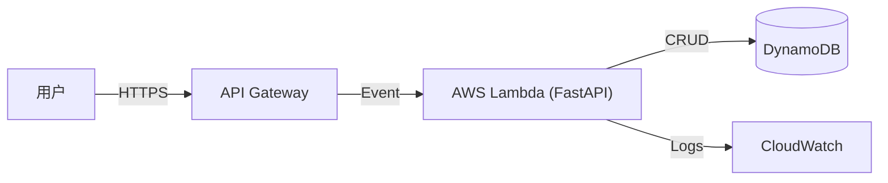

# AWS Serverless 架构分析报告 (Python + FastAPI + DynamoDB)

## 1. 架构概览 (Architecture)

本方案采用 **AWS Serverless** 架构，核心组件包括：

*   **计算层 (Compute)**: **AWS Lambda** 运行 **Python 3.11+** 环境。
*   **Web 框架**: **FastAPI**，通过 `Mangum` 适配器运行在 Lambda 上。FastAPI 提供高性能的异步处理能力和自动化的 OpenAPI 文档。
*   **入口层 (Entry Point)**: **Amazon API Gateway (HTTP API)**，负责路由请求到 Lambda，并处理部分鉴权和限流。
*   **数据层 (Database)**: **Amazon DynamoDB**，完全托管的 NoSQL 数据库，提供毫秒级响应。
*   **基础设施即代码 (IaC)**: 推荐使用 **AWS SAM** 或 **Serverless Framework** 进行部署管理。

### 架构图

---

## 2. 性能分析 (Performance)

### 优势
*   **高并发**: Lambda 能够根据请求量自动水平扩展，理论上可以处理数万并发请求（受限于 AWS 账号配额）。
*   **低延迟**: DynamoDB 在设计良好的 Access Pattern 下，读写延迟通常在个位数毫秒级别。
*   **FastAPI**: 基于 Starlette 和 Pydantic，是目前最快的 Python Web 框架之一，支持异步 (`async/await`)，非常适合 I/O 密集型任务。

### 挑战与优化
*   **冷启动 (Cold Starts)**: Lambda 在闲置一段时间后，首次请求需要初始化环境，可能产生 1-3 秒的延迟。
    *   *优化*: 使用 **Provisioned Concurrency** (预置并发) 保持热实例；精简 Python 依赖包大小；使用 Lambda Layers。
*   **连接管理**: Serverless 环境下无法使用传统的数据库连接池。
    *   *优化*: DynamoDB 使用 HTTP 协议，无连接池问题。如果连接 RDS (MySQL)，则需要使用 RDS Proxy。

---

## 3. 成本分析 (Pricing)

AWS Serverless 采用 **按量付费 (Pay-as-you-go)** 模式，对于初创项目和波动性流量非常友好。

### 核心成本构成
1.  **AWS Lambda**:
    *   按 **请求次数** ($0.20/百万次) 和 **GB-秒** (内存大小 * 运行时间) 计费。
    *   *优势*: 无流量时不收费。
2.  **API Gateway (HTTP API)**:
    *   $1.00/百万次请求 (前3亿次)。比 REST API 便宜 70%。
3.  **Amazon DynamoDB**:
    *   **按需模式 (On-Demand)**: 按读写请求单元 (RRU/WRU) 计费。适合流量不确定的场景。
    *   **预置模式 (Provisioned)**: 预先设定读写能力，更便宜，适合流量稳定的场景。
    *   *存储*: $0.25/GB/月。
4.  **数据传输**: 流出互联网的数据流量费用。

### 成本估算示例 (月)
假设：100万次请求，每次 Lambda 运行 200ms (512MB 内存)，DynamoDB 读写各 100万次。
*   Lambda: ~$1.5
*   API Gateway: ~$1.0
*   DynamoDB: ~$1.5
*   **总计**: **<$5.0 / 月** (甚至可能完全覆盖在 AWS Free Tier 免费层级内)

---

## 4. 现代 Web App 开发考量

### 开发体验 (DX)
*   **本地开发**: 可以使用 `uvicorn` 本地运行 FastAPI，配合本地 DynamoDB (DynamoDB Local) 或 Mock，开发体验与传统模式一致。
*   **调试**: 配合 AWS SAM CLI 可以本地模拟 Lambda 环境。
*   **类型安全**: FastAPI 深度集成 Pydantic，提供运行时数据验证和 IDE 自动补全。

### 可维护性
*   **无服务器运维**: 无需管理 EC2 实例、操作系统补丁、Nginx 配置等。
*   **单一职责**: 倾向于将不同功能拆分为不同的 Lambda 函数（微服务），或使用 Monolith Lambda (整个 FastAPI 一个函数) 简化部署。本方案目前采用 Monolith 模式，适合中小型项目快速迭代。

### 扩展性
*   **功能扩展**: 易于集成 AWS 生态服务，如 S3 (文件存储)、SQS (消息队列)、EventBridge (事件总线)、Cognito (用户认证)。

---

## 5. 总结

使用 **Python + FastAPI + DynamoDB + Lambda** 构建 Web App 是目前极具竞争力的现代化技术栈。它结合了 Python 的开发效率、FastAPI 的高性能、以及 AWS Serverless 的低运维成本和无限扩展能力。对于 **DadaIsland** 这样的平台，这是一个能够支撑从 0 到 100 万用户增长的理想架构。
